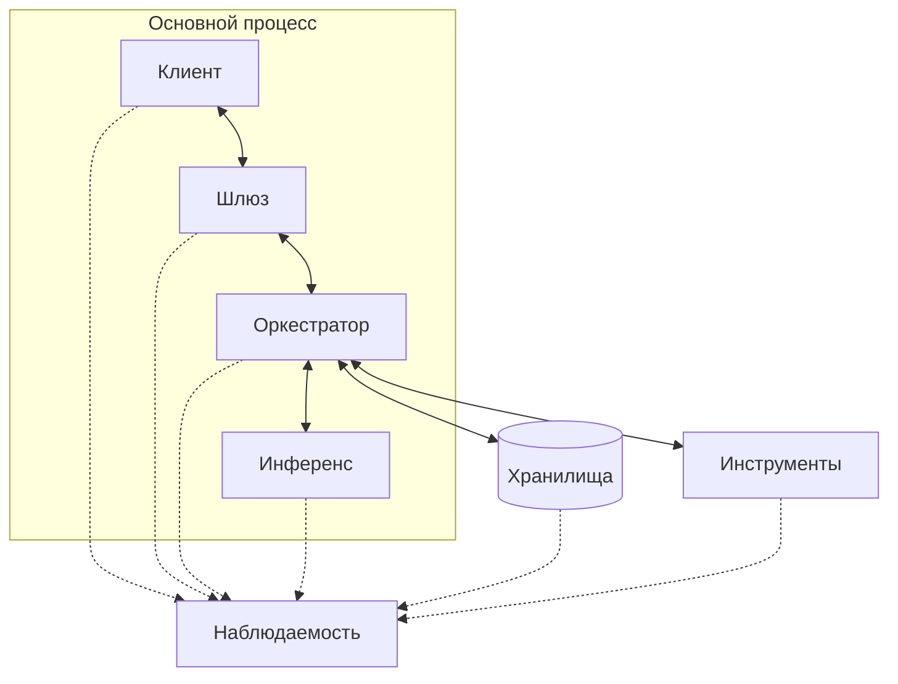

# Design doc: Content Revision Control

Основан на шаблоне команды [Reliable ML](https://github.com/IrinaGoloshchapova/ml_system_design_doc_ru/blob/main/ML_System_Design_Doc_Template.md) и на [design doc курса «Современные методы NLP»](https://github.com/xufana/modern_nlp_llm/blob/main/hw/hw_01.md); порядок разделов перестроен под методику этого курса: контракт → бюджеты → eval → baseline → усложнения.

| | |
|---|---|
| Авторы | Шебалкова Дарья, БПМИ245 |
| Версия | 0.3 |
| Статус | черновик |
| Обновлён | 30.10.2026 |
| ADR | [`adr/`](./adr/) |

## Как пользоваться шаблоном

- Документ живой: заполняется по ходу курса и правится, когда меняется решение. Не переписывайте историю — добавляйте запись в «Историю изменений» внизу.
- Порядок разделов — это порядок работы. Не заполняйте раздел 6, пока пустой раздел 5.
- Всё в квадратных скобках заменить своим текстом. Раздел без единого числа считается незаполненным.
- Если пункт не применим — так и напишите: «не применимо, потому что …». Пустая строка и «не применимо» — разные вещи.
- Курсивом в разделах — вопросы, которые будут заданы на защите. Если на вопрос нет ответа в тексте, его зададут вслух.
- Каждое архитектурное решение, у которого были альтернативы, оформляется отдельным ADR (см. `adr_template.md`) и упоминается здесь ссылкой.

**Когда что заполнять**

| Раздел | Когда | Контрольная точка |
|---|---|---|
| 1 (контекст), 2 (контракт и сценарии), 3.1–3.4 (бюджеты), черновик 5.1 (20 запросов) | после занятия 1 | КТ 1 |
| 3.2 задержка и 3.3 стоимость — с расчётами по железу | после занятия 2 | КТ 1 |
| 4 (архитектура, данные, промпты), 6.1 (baseline) | после выбора стека | КТ 2 |
| 5 целиком (eval-план), 3.5 (SLI/SLO) | после занятия про eval, примерно неделя 6 | КТ 2 |
| 6.2 (усложнения), 7, 8, 9, 10, 11 | по мере проекта | защита |

---

## 1. Контекст проекта

### 1.1 Бизнес-задача

- **Проблема.** Методист поддерживает учебные материалы, получает вопросы студентов, замечания преподавателей и комментарии авторов. Затем вручную определяет, указывает ли обратная связь на реальный дефект, находит нужный фрагмент, готовит правку и проверяет, что изменение не исказило ранее корректное содержание.
При последовательных AI-правках возникает риск содержательного дрейфа: текст разрастается, теряет важные шаги объяснения. Организации также сложно отследить, какие изменения и почему были сделаны, кто утвердил новую версию материала.
- **Зачем используется LLM.** Поиск и регулярные выражения могут найти ключевые термины, формулы и заранее известные условия, но не могут интерпретировать свободный вопрос студента, отличить реальный пробел в объяснении от вопроса вне темы и подготовить понятную локальную правку. Обычный чат-бот может переписать текст, но не создаёт проверяемый diff, не контролирует содержательные регрессии, не поддерживает версионирование.
- **Почему именно это решение имеет смысл.** Вместо полной перегенерации конспекта Content Revision Control предлагает минимальный patch к конкретному фрагменту, проверяет его и передаёт решение методисту. Это сохраняет контроль человека над содержанием, защищает от разрастания и порчи остального корректного текста и позволяет измерять качество правок.
- **Критерии успеха с точки зрения бизнеса.**
   - North-star — доля одобренных первых предложенных правок без `Request Changes` и редактирования из всех запросов с исправимым дефектом материала, цель ≥ 60 %.
  - Методист получает готовый diff, обоснование и результаты проверок вместо ручного поиска места и подготовки первого варианта правки.
  - Система не публикует ни одной правки без явного решения владельца материала.
  - Организация получает историю изменений и решений по материалам, достаточную для разбора спорной правки или содержательной ошибки.
  - Гипотеза: полная обработка запроса занимает в среднем ≤ 5 минут активной работы методиста вместо 10–15 минут вручную, включая доработки и повторный review. При 300 запросах это 25 против 50–75 часов в месяц.

### 1.2 Пользователи и сценарии использования

- **Кто.** Клиент — образовательная организация, поддерживающая математические курсы на русском языке. Основные пользователи — методисты и редакторы, отвечающие за актуальность и качество учебных материалов.
В MVP система пилотируется на одном предметном профиле: **«Линейная алгебра и матричные вычисления»**. Предполагается 1–3 методиста или редактора.
- **Через что.** Локальное веб-приложение: методист вводит замечание, указывает фрагмент и просматривает результат обработки. Для предложенной правки доступны diff, результаты проверок и действия «Одобрить», «Отклонить», «Вернуть на доработку». История предложений и комментариев сохраняется.
- **Нагрузка.** До 10 запросов в день, 300 в месяц и двух одновременных обработок.
- **Цена ошибки.** Искажение математического объяснения, потеря условий теоремы, создание противоречий с другим разделом курса. Это снижает доверие к материалам и увеличивает нагрузку на методиста.

### 1.3 Границы, ограничения и допущения

**Границы системы.** 

| Внутри: наш код и данные | Снаружи: провайдер, внешний API или пользователь |
|---|---|
| Хранилище учебных материалов MVP, версий, change requests, diffs и решений методиста | LLM API: доступность, стоимость, задержка, ограничения и возможные изменения модели |
| Формирование контекста: исходный запрос, выбранный фрагмент, соседние абзацы, связанные фрагменты корпуса и комментарии review | Предметная корректность исходных учебных материалов до загрузки в систему |
| Классификация результата запроса: `proposed_patch`, `no_change`, `needs_human_decision`, `invalid_request` | Финальная содержательная оценка правки и решение об approval со стороны методиста |
| Детерминированные проверки JSON Schema, валидности синтаксиса LaTeX, длины и области diff, идентификатора фрагмента и версии документа |  |
| Поиск потенциальных противоречий с утверждёнными фрагментами корпуса |  |
| Логи, traces, хранение метаданных прогона и воспроизводимый eval |  |

**Что явно не делаем.** 
- Не создаём учебные материалы, конспекты или доказательства с нуля.
- Не применяем правки автоматически: любое изменение требует `Approve` от владельца материала.
- Не обрабатываем в MVP произвольные дисциплины, изображения, сканы PDF и материалы вне предметного профиля «Линейная алгебра и матричные вычисления».
- Не интегрируемся в MVP с LMS, Telegram, Google Docs, Яндекс почтой или внешними системами тикетов.
- Не обещаем автоматически доказать корректность предложенной правки или отсутствие всех содержательных ошибок.
- Не строим долгосрочные профили студентов, преподавателей или методистов.

**Допущения**, которые ещё не проверены:
 1) о данных:
     - Доступен PDF «matcompbook.pdf»; LaTeX-исходник планируется запросить у авторов. Для eval выбираются отдельные фрагменты; до получения исходника они записываются в LaTeX и сверяются по PDF вручную.
 2) о безопасности и нормативах:
    - Внешний LLM API допустим для учебного MVP, если в промпт не передаются персональные данные и закрытые материалы.
    - В корпусе и тестовых запросах нет персональных данных студентов; текст запроса очищается от ФИО и идентификаторов перед отправкой в LLM.
 3) о поведении пользователей:
     - Методист часто сталкивается с необходимостью локальных правок текста, на что тратит много времени.
     - Методист готов потратить до 5 минут активной работы с системой на полную обработку вопроса.
     - Вопрос студента является сигналом о возможном дефекте, но не автоматическим основанием для изменения текста.


---

## 2. Контракт сервиса

### 2.1 Контракт

| Поле | Что обещаем | Как проверим (ссылка на метрику из 5.2) |
|---|---|---|
| **Вход** | Документ и его версия, обязательный ID выбранного фрагмента, русскоязычный change request длиной 1–1 000 символов после удаления пробелов по краям и `signal_type`: `student`, `author` или `methodist` | Проверка обязательных полей, длины замечания, допустимого `signal_type`, существования документа, версии и принадлежности фрагмента этой версии; тесты невалидного ввода |
| **Выход** | Один из результатов: `no_change` - 	правка не нужна (есть объяснение и подтверждающий фрагмент); `proposed_patch` - обнаружен исправимый дефект, подготовлена правка (old/new, diff, обоснование, источники и результаты проверок);`needs_human_decision` - система не может подготовить проверенную правку в рамках задачи; требуется ручной разбор (причина и следующее действие); `invalid_request` - ошибка входных данных: пустой запрос, неизвестный документ и тп (ошибочное поле и причина). Без предложения `patch=null` | JSON Schema; доля валидных структурированных ответов |
| **Поведение при неуверенности** | Если запрос не относится к закрепленному материалу, выходит за пределы предметного профиля, требует новой теоремы или проверки недостаточно надёжны, система не генерирует patch и возвращает `needs_human_decision` | Доля запросов, требующих ручного разбора, для которых система вернула needs_human_decision с правильной причиной |
| **Нефункциональные** | e2e P95 ≤ 120 секунд; данные MVP хранятся в локальной БД; персональные данные не отправляются в LLM и не попадают в логи | трейсы, логи, тесты маскирования |

**Границы правки.** Изменяется только выбранный фрагмент либо добавляется текст в указанном месте (рядом с фрагментом, до либо после). Остальной материал сохраняется. Правка применяется только после одобрения методиста.

**Контракт одной фразой** По замечанию к учебному материалу сервис предлагает проверенную локальную правку, подтверждает отсутствие необходимости изменения либо объясняет, почему запрос не обработан автоматически; применение правки требует одобрения методиста.

### 2.2 Сценарии взаимодействия

**Основные сценарии.**

| Сценарий | Пример запроса | Что делает система | Результат для пользователя |
|---|---|---|---|
| Реальный содержательный дефект | «После определения обратной матрицы не сказано, при каком условии она существует» | Анализирует выбранный фрагмент, готовит локальную правку и проверяет её | proposed_patch: diff и результаты проверок; методист может одобрить исправление. |
| Непонятное объяснение | «После определения непонятно, почему порядок умножения матриц важен» | Проверяет наличие объяснения в материале | Пробел подтверждён — patch; ответ уже есть — `no_change`; вопрос неясен — `needs_human_decision` |
| Вопрос без дефекта | «Что такое определитель?», когда определение уже есть в выбранном материале | Находит существующий ответ и не предлагает переписывание текста | `no_change` с объяснением и ссылкой на фрагмент |

**Исключительные сценарии.**

| Ситуация | Поведение системы | Что видит пользователь |
|---|---|---|
| Запрос вне домена | Не вызывает генерацию patch | `needs_human_decision`: запрос вне предметного профиля; правка не создана |
| Контекста недостаточно | Передаёт решение методисту | `needs_human_decision` с причиной |
| Найдено потенциальное противоречие со связанным фрагментом корпуса | Система возвращает `needs_human_decision` | Объяснение и конфликтующие фрагменты. Готовая правка для одобрения отсутствует. |
| LLM вернула невалидный формат | Один retry в пределах оставшегося времени; затем `needs_human_decision` | «Не удалось подготовить структурированную правку; требуется ручной review» |
| Исчерпан лимит времени | Останавливает обработку и сохраняет trace, `needs_human_decision` | «Проверка не завершена в допустимое время; изменение не применено» |
| Методист не согласен с patch | Сохраняет решение и комментарий `Reject` или `Request changes`. Если `Request changes`: повторный запуск | Правка не публикуется; история решения доступна в карточке запроса |
| Замечание пустое или длиннее 1 000 символов | Валидатор видит нарушение контракта и не запускает обработку | `invalid_request` с указанием ошибки |
| Фрагмент не выбран | Интерфейс блокирует отправку; API при отсутствии ID возвращает `invalid_request` без вызова LLM | «Выберите фрагмент материала» |

### 2.3 Диалоговая логика и тон

- **Single-turn или multi-turn.** Один запрос относится к одному фрагменту. Дополнительный ввод допускается для уточнения замечания и доработки предложенной правки.
- **История диалога.** Память хранится в БД в сущности `change request`: исходный запрос, документ и его версия, выбранный фрагмент, версии patch, комментарии review, результаты проверок и итоговый статус. При каждом вызове оркестратор собирает промпт из системных инструкций, исходного запроса, текущего фрагмента, до двух соседних абзацев и до двух связанных фрагментов, найденных
retrieval-поиском. 

    - При `Request changes` в контекст дополнительно передаются последняя версия patch и последний комментарий методиста. История прошлых запросов по тому же фрагменту хранится в БД и доступна в интерфейсе; в промпт включаются последнее утверждённое изменение этого же фрагмента и последние незакрытые замечания к нему и его родительскому разделу в том же документе. Для вставки используется ID существующего фрагмента, рядом с которым вставляется новый текст. История хранится до удаления проекта владельцем. При переполнении контекста убираются связанные фрагменты с меньшей оценкой поиска, затем соседние абзацы. Запрос, цель и последнее review не обрезаются; если они не помещаются, возвращается `needs_human_decision`. Правило поиска связанных фрагментов уточняется в 4.3.

    - Если система вернула `needs_human_decision` из-за неясного замечания, методист может добавить уточнение. Исходное замечание и уточнение сохраняются в истории одного запроса; выбранный фрагмент и базовая версия документа остаются прежними. Уточнение запускает новую обработку.

- **Долгая память о пользователе.** Не применяется в MVP: система не строит профиль студента, преподавателя или методиста между сессиями.
- **Тон и стиль.** Интерфейс и объяснения — на русском, нейтральный профессиональный стиль, без эмодзи. Patch должен быть коротким, конкретным и не содержать неподтверждённых утверждений.
- **Прозрачность.** Интерфейс явно сообщает в начале чата, что текст patch подготовлен AI и требует решения методиста.

---

## 3. Три бюджета и SLO

### 3.1 Качество

| Метрика (из контракта) | Как считаем | Целевое значение | Ниже чего — откат |
|---|---|---|---|
| Доля валидных структурированных ответов | Число первых ответов LLM, прошедших JSON Schema / все первые ответы LLM. Запросы без вызова модели исключаются. | ≥ 98 % | < 95 % |
| Recall@3 поиска по тексту | Число тестовых отрывков, для которых нужный фрагмент найден среди трёх первых результатов / все отрывки с размеченным фрагментом. Правильный ID системе не передаётся. Выбор по разделу оценивается отдельно | ≥ 85 % | < 75 % |
| Доля корректных `no_change` | Доля запросов без дефекта, для которых возвращён `no_change` с объяснением, отвечающим на замечание, и верной ссылкой на материал. Ошибки обработки и эскалации не засчитываются. | ≥ 80 % | < 70 % |
| Доля корректных эскалаций | Число запросов с эталонным needs_human_decision, для которых правильно возвращены статус и причина / все такие запросы. Технические сбои успехом не считаются. | ≥ 85 % | < 75 % |
| Одобрение первой правки (north-star) | Approve первой версии без редактирования и Request changes / все запросы с подтверждённым исправимым локальным дефектом. Отсутствие patch и сбои — неуспех. | ≥ 60 % | < 50 % |
| Обязательные проверки patch | Число показанных предложений, прошедших проверки ID, базовой версии, области изменения и поддержанного синтаксиса LaTeX / все показанные предложения. | 100 % | Нарушение блокирует предложение |
| Применение без approval | Число изменений без соответствующего Approve | 0 | Любое нарушение блокирует применение |
| Доля ошибочных правок | Число показанных правок, в которых разметчик обнаружил математическую ошибку или искажение ранее корректного содержания / все показанные правки | ≤ 5 % | > 10 % |
| Наличие ссылки на фрагмент при ответе | Число результатов proposed_patch и no_change со ссылкой на существующий фрагмент материала / все результаты этих двух типов | 100 % | Нарушение блокирует предложение |


### 3.2 Задержка

| Этап | Оценка, мс | Откуда число |
|---|---:|---|
| сеть + шлюз | 100 | Предварительное допущение по ориентиру занятия 2 |
| retrieval | 300 | Верхняя граница ориентира занятия 2; требуется замер на нашем корпусе |
| ожидание до первого фрагмента | 4 520 | Время до первого фрагмента ответа GPT‑6.1 Sol (`medium`) на Artificial Analysis. Включает ожидание обработки API, а не только prefill |
| decode (N токенов × TPOT) | 10 380 | N = 550 видимых токенов; скорость — 53 токена/с по Artificial Analysis; TPOT ≈ 18,9 мс |
| инструменты | 2 000 | Допущение: проверки JSON, LaTeX, области изменения, построение diff и сохранение |
| × число шагов агента | 1; до 2 вызовов при retry | Фиксированный процесс, одна повторная попытка при невалидном формате |
| **Итого e2e, P50 / P95** | **Не измерены / не измерены** | Грубая оценка одной попытки — около 17 300 мс. |

Отсчёт начинается при отправке замечания с подтверждённым фрагментом. Предварительный поиск и время выбора пользователем в e2e не входят.

Целевые значения: e2e P95 ≤ 120 с, включая очередь, retrieval, все вызовы и проверки. Повторная попытка использует оставшееся время. При исчерпании лимита возвращается `needs_human_decision` без patch. Стриминг текста - нет. Во время обработки показываются этапы: «Поиск», «Подготовка правки», «Проверка». Новый текст и diff появляются только после завершения проверок.

Модель:
GPT‑6.1 Sol (reasoning.effort=medium)

### 3.3 Стоимость
```text
cost_per_request ≈ calls × (tokens_in × price_in + tokens_out × price_out) / 1 000 000
cost_per_month   = cost_per_request × requests_per_month
```

| Параметр | Значение | Откуда |
|---|---|---|
| tokens_in на вызов: системный промпт, контекст и история | 3 000 | Предварительная оценка размера входа |
| tokens_out на вызов | 1 550 | Допущение: 550 видимых + 1 000 reasoning-токенов; фактический объём проверяется по usage |
| вызовов модели на запрос | Обычно 1, максимум 2 | Одна повторная попытка при невалидном формате |
| price_in / price_out | $2 / $10 за 1M токенов | OpenAI API, GPT‑6.1 Sol, стандартный тариф; проверен 30.10.2026 |
| requests_per_month | 300 | Нагрузка из 1.2 |
| **cost_per_request** | **$0,0215** | Одна попытка: (3 000 × 2 + 1 550 × 10) / 1 000 000 |
| **cost_per_month** | **$6,45** | 300 запросов без повторных попыток |

При двух одинаковых попытках стоимость запроса — $0,043. Месячная стоимость: $6,45 × (1 + доля запросов с повтором). Кэширование не учитывается. (Стоимость верна при одинаковом среднем объёме первой и второй попытки).

Расчёт включает только генеративную модель. Хостинг, индексация и выполнение retrieval добавляются после выбора инфраструктуры.

Скрытая стоимость: оплата подготовки и проверки eval, разработки обвязки и интерфейса, поддержки сервиса.

Источник тарифа: https://developers.openai.com/api/docs/models/gpt-6.1-sol

### 3.4 Компромисс

Главный бюджет — качество правок: математическая ошибка в материале важнее небольшой экономии на API. Поэтому допускаем обработку до 120 секунд для 95 % запросов и используем проверки перед показом предложения. При недостаточном контексте или конфликте передаём решение методисту, жертвуя долей автоматически подготовленных правок. При этом эскалации исправимых дефектов снижают north-star: безопасность не должна достигаться передачей всех запросов человеку.

---

### 3.5 SLI и SLO

Показатели считаются за 30 дней пилота; canary — перед каждым релизом.

| SLI | Как считаем | SLO | Error budget |
|---|---|---|---|
| Доступность | Время доступности интерфейса и API / запланированное время работы пилота; проверка раз в минуту | ≥ 99 % | Недоступность ≤ 1 % времени |
| e2e P95 | Трейсы от отправки замечания с подтверждённым фрагментом до готового проверенного результата, включая очередь и повторы | ≤ 120 с | ≤ 5 % запросов без готового результата за 120 с; технические сбои также считаются нарушением |
| Доля валидных по формату ответов | Первые ответы LLM, прошедшие JSON Schema / все первые ответы LLM | ≥ 98 % | ≤ 2 % невалидных первых ответов |
| Подтверждение объяснения материалом (groundedness)| Число проверенных результатов, где указанный фрагмент подтверждает объяснение / все результаты в проверенной выборке; оценивает предметный эксперт | ≥ 90 % | ≤ 10 % неподтверждённых |
| Ссылки на источник | Число результатов `proposed_patch` и `no_change` со ссылкой на существующий фрагмент / все результаты этих типов; проверяет код | 100 % | Результат без корректной ссылки блокируется |
| Доля корректных отказов | Правильные `needs_human_decision` с причиной / все размеченные случаи ручного разбора; технические сбои не засчитываются | ≥ 85 % | ≤ 15 % ошибок на этом срезе |
| Успешность вызова инструментов | Вызовы поиска, получения фрагментов, проверок, diff и БД без технической ошибки / все вызовы | ≥ 99 % | ≤ 1 % технических ошибок; обнаруженный дефект текста не считается сбоем инструмента |
| Оценка на canary eval-сете | Доля успешных случаев на 20 фиксированных примерах перед релизом | Не ниже baseline − 5 п.п.; обязательные проверки — 100 % | Не более одного потерянного успешного случая относительно baseline; нарушение обязательной проверки блокирует релиз |
| Пользовательский фидбек | Первые предложения с `Reject` или `Request changes` / все рассмотренные первые предложения | ≤ 40 % | ≤ 40 % отрицательных решений; для каждого сохраняется причина |
| North-star | По определению из 3.1: первые правки, одобренные без редактирования и Request changes / все запросы с подтверждённым исправимым дефектом | ≥ 60 % | ≤ 40 % неуспешных случаев |
| Активное время методиста | Суммарное активное время, включая выбор фрагмента, review и доработки / число завершённых запросов | В среднем ≤ 5 минут | Не применяется; превышение требует пересмотра гипотезы экономии времени |

Активное время методиста рассчитывается таймером.

**Сбор фидбека.** Решения и комментарии методиста сохраняются в истории запроса. Отдельные кнопки 👍/👎 не нужны.

Кто смотрит на дашборд и что делает, когда SLO нарушен: Дарья Шебалкова проверяет показатели еженедельно и перед релизом. Нарушение обязательных проверок останавливает применение правок; остальные превышения разбираются по причинам.

## 4. Архитектура решения

### 4.1 Схема по семи блокам



| Блок | Что делает в нашей системе | Берём готовое | Пишем сами и почему |
|---|---|---|---|
| Клиент | Ввод замечания, выбор фрагмента, просмотр результата и review | React, компонент diff, KaTeX | Экран обработки замечания и действия методиста — интерфейс проекта |
| Шлюз | Проверка входа, аутентификация, права на документ, ограничения запросов | FastAPI, Pydantic, средства управления сессиями | Правила доступа и входная схема — зависят от контракта |
| Оркестратор | Собирает контекст, вызывает модель и проверки, управляет временем и единственным retry | Python, SDK провайдера (библиотека openai) | Фиксированный порядок обработки и выбор истории — логика проекта; агентный цикл не нужен |
| Движок инференса | Генерирует решение и текст правки | GPT‑6.1 Sol через OpenAI API | Собственный инференс не разрабатываем |
| Хранилища | Материалы, версии, векторы фрагментов, запросы, предложения и решения | PostgreSQL | Структура таблиц и сохранение утверждённой правки с проверкой версии документа |
| Инструменты | Поиск фрагментов и связанного контекста, разбор LaTeX, построение diff и проверки | text-embedding-3-large через OpenAI API; pgvector; полнотекстовый поиск PostgreSQL; pylatexenc, difflib, JSON Schema | Объединение результатов поиска, отбор контекста и контроль области изменения |
| Наблюдаемость | Записывает этапы, задержку, ошибки, usage и решения review | OpenTelemetry, стандартное логирование Python | Добавляем запись времени, ошибок и расхода токенов по каждому запросу для расчёта SLI|

### 4.2 Путь одного запроса

1. **Приём запроса — API -> PostgreSQL.** API проверяет вход, пользователя и доступ к документу по `users`, `document_permissions`, `documents` и `document_versions`. Проверяет обязательный ID фрагмента и его принадлежность указанной версии по `fragment_versions`. Невалидный ввод возвращает `invalid_request`, отсутствие прав — HTTP 403. При успешной проверке в одной транзакции создаются запрос в `change_requests` со ссылкой на базовую версию и задание в `jobs`.

2. **Загрузка фрагмента — worker -> PostgreSQL.** Worker забирает задание из `jobs` и получает текст выбранного фрагмента из `fragment_versions` по переданному ID и базовой версии документа.

3. **Подготовка контекста — worker -> PostgreSQL.** Worker получает выбранный фрагмент и до двух соседних фрагментов из базовой версии документа. Затем выполняет поиск до двух связанных фрагментов по правилам [4.3](#43-данные-и-база-знаний). История предложений, уточнений и комментариев добавляется по правилам [2.3](#23-диалоговая-логика-и-тон).

4. **Генерация — worker -> OpenAI API.** Worker загружает `prompts/propose_patch.md`. Передаёт системную инструкцию и данные: замечание, `signal_type`, версию документа, выбранный фрагмент, соседний и связанный контекст, допустимые ID и историю. После `Request changes` добавляет последнее предложение и комментарий методиста. При обработке уточнённого замечания в промпт передаются исходное замечание и последующие уточнения методиста. JSON Schema передаётся через Structured Outputs; эталоны eval в запрос не входят.

5. **Разбор ответа и повтор — worker.** Worker проверяет завершённость ответа, JSON Schema и совместимость полей. При ошибке формата допускается один retry: исходные инструкции и данные дополняются предыдущим ответом и перечнем ошибок. Повтор использует остаток общего лимита 120 секунд; автоматические повторы SDK отключены. При окончательном сбое сохраняется `needs_human_decision` с технической причиной.

6. **Проверки — worker -> инструменты и PostgreSQL.** Для `proposed_patch` worker проверяет существование ID, допустимую область изменения, поддержанный синтаксис. Исходный текст берётся из `fragment_versions`, новый — из ответа модели; diff строится кодом. Для `no_change` проверяется наличие объяснения и существование указанного источника. Нарушение обязательной проверки блокирует готовый результат и переводит запрос на ручной разбор. Для `proposed_patch` и `no_change` проверяются наличие объяснения, существование указанных источников, их принадлежность зафиксированным версиям и права доступа пользователя.


7. **Сохранение и показ — worker -> PostgreSQL -> интерфейс.** Предложение записывается в `patch_revisions`, результаты проверок — в `validation_runs`, итог обработки — в `change_requests`, статус задания — в `jobs`. API возвращает сохранённый результат интерфейсу. До завершения проверок показываются только этапы обработки; после — diff либо объяснение отсутствия правки.

8. **Решение методиста — API -> PostgreSQL.** Решение и комментарий сохраняются в `review_events`. При `Approve` одна транзакция повторно проверяет права, ревизию предложения и текущую версию документа, создаёт записи в `document_versions` и `fragment_versions`, обновляет текущую версию и добавляет задание переиндексации в `jobs`. Устаревшая база возвращает HTTP 409 без применения; повторный Approve не создаёт вторую копию изменения. `Reject` закрывает предложение. `Request changes` сохраняет комментарий и создаёт задание подготовки следующей ревизии, не меняя материал.

   - Если результат — `needs_human_decision` с причиной «неясное замечание», методист может отправить уточнение. API проверяет его длину по правилам входного замечания и сохраняет в истории запроса, затем создаёт новое задание в `jobs`. Обработка повторяется с шага 2 с учётом уточнения. Предыдущий результат сохраняется в истории; учебный материал не изменяется.

На каждом этапе записываются ID запроса, длительность и ошибки; для вызовов модели — также расход токенов. Эти записи используются для расчёта SLI.

*Спросят со всех: где лежит база, когда мы в неё ходим, где лежит промпт, в каком порядке обрабатывается запрос.*

### 4.3 Данные и база знаний

**Чувствительность.** Внешнему API передаются только разрешённые учебные материалы и обезличенные замечания. ФИО, контакты и идентификаторы студентов удаляются до сохранения запроса.

**Источники.**

| Источник | Формат | Объём | Владелец | Как обновляется |
|---|---|---|---|---|
| Учебные материалы по линейной алгебре и матричным вычислениям | Сейчас PDF; LaTeX запрашивается у авторов | примерно 120 страниц A4; первоначально используются выбранные фрагменты | Авторы материала; импорт выполняет Дарья | Ручная загрузка и сверка с источником |
| Утверждённые изменения | LaTeX и записи PostgreSQL | Накапливаются в пилоте | Методист | После `Approve` |

**Предобработка.** LaTeX разбирается через `pylatexenc`. Фрагменты выделяются по структуре: абзац, определение, теорема или пояснение; формулы и [окружения](#11-приложения) не разрезаются. Ориентир — 100–500 токенов на фрагмент,  Перекрытие не используется: соседние фрагменты добавляются отдельно при сборке контекста.

Для каждого фрагмента сохраняются постоянный ID, текст LaTeX, версия документа, родительский раздел, порядок и границы в исходнике (`start_offset`, `end_offset`). Изменение текста создаёт новую версию фрагмента с тем же ID; разделение или объединение — новые ID.

Повторно загруженные файлы с тем же содержимым не импортируются. Формулы и таблицы сохраняются в исходном LaTeX.

**Индексация.** Предварительно выбрана `text-embedding-3-large` через OpenAI API; размерность вектора — 3 072. Векторы хранятся в pgvector; используется точный поиск по косинусной близости. Поиск гибридный: векторный и полнотекстовый PostgreSQL, результаты объединяются через RRF. Поиск места правки ограничен выбранным документом и его версией. Окончательный выбор между `text-embedding-3-small` и `text-embedding-3-large` — по Recall@3 поиска по вставленному тексту на материалах курса.

**Поиск для выбора фрагмента.** Выполняется до отправки замечания. По вставленному тексту гибридный поиск возвращает до трёх кандидатов из выбранной версии документа. По номеру или названию раздела система показывает соответствующие разделы и их фрагменты. Пользователь подтверждает конкретный фрагмент; автоматически цель не выбирается. Если результатов нет, предлагается изменить текст или указание раздела.

**Поиск связанного контекста.** Выполняется после отправки замечания, когда пользователь уже подтвердил целевой фрагмент. Поиск ограничен тем же документом и его базовой версией.

Поисковый запрос составляется из текста выбранного фрагмента и замечания пользователя. При повторной обработке к замечанию добавляются уточнения; после `Request changes` — последний комментарий методиста.

Используется гибридный поиск: векторный и полнотекстовый PostgreSQL; результаты объединяются через RRF. Из кандидатов исключаются выбранный фрагмент и соседние фрагменты, уже включённые в контекст. Повторяющиеся ID удаляются. В промпт передаются первые два оставшихся результата; если найден только один — один, если ни одного — обработка продолжается без связанного контекста.

Если контекста недостаточно для решения или обнаружено потенциальное противоречие, возвращается `needs_human_decision` с причиной.

Для каждого переданного фрагмента сохраняются ID и версия. Связанные фрагменты используются только как контекст и источники; область правки остаётся ограниченной выбранным фрагментом или вставкой непосредственно до либо после него.

При превышении входного лимита связанные фрагменты исключаются начиная с последнего в объединённой выдаче, затем применяется порядок сокращения контекста из 2.3.

**Обновление.** После каждого `Approve` система автоматически создаёт новую версию документа, обновляет границы фрагментов и пересчитывает эмбеддинги и полнотекстовый индекс для изменённых и добавленных фрагментов. Индекс обновляется фоновым заданием после сохранения новой версии. До завершения обновления поиск по новой версии недоступен; интерфейс показывает статус обновления. Старые версии сохраняются для истории, но исключаются из текущего поиска. При смене модели эмбеддингов векторный индекс пересобирается полностью. Методист отвечает за утверждение изменений, разработчик — за исправление сбоев обновления.

**Качество знаний.**

| Метрика | Как считаем | Цель |
|---|---|---|
| Покрытие: доля запросов eval, для которых база содержит достаточно материала для принятия решения | Число вопросов, для которых эксперт подтвердил наличие достаточного контекста в базе / все содержательные вопросы eval; невалидные и внепредметные исключаются | ≥ 90 % |
| Актуальность: сколько времени от изменения источника до попадания в базу | Время от `Approve` до доступности обновлённой версии в поиске | P95 ≤ 60 с |
| Консистентность: дубли, противоречия между документами | Проверка дублей загрузки, разрешимости ссылок и согласованности версий кодом; содержательных противоречий — при review и разборе замечаний | 0 технических нарушений в активной базе; обнаруженные содержательные конфликты блокируют связанную правку до решения методиста |

### 4.4 Модель и промпты

- **Модель.** Предварительно GPT‑6.1 Sol через OpenAI API, `reasoning.effort=medium`: математические способности и поддержка Structured Outputs. Качество на нашем eval [ещё не измерено](#10-открытые-вопросы); оценки цены и задержки — в 3.2–3.3.

- **Промпты.** Системная инструкция, замечание, выбранный и найденные фрагменты, история по [2.3](#23-диалоговая-логика-и-тон). При retry добавляются предыдущий ответ и ошибки формата. JSON Schema передаётся отдельно через API. Шаблоны хранятся в [./prompts/](./prompts/) и версионируются в Git.

- **Ограничения.** Начальные лимиты: вход ≤ 6 000 токенов, выход ≤ 2 500 токенов, включая reasoning. Они ограничивают объём обработки и расходы. `temperature` не задаётся; используется выбранный режим reasoning. Превышение входного лимита обрабатывается по правилам [2.3](#23-диалоговая-логика-и-тон).

- **Версионирование и откат.** Используется ID `gpt-6.1-sol`; фиксированная версия модели пока не выбрана. Для каждого запуска сохраняются ID модели, настройки и Git-коммит, содержащий промпт и JSON Schema. Изменения проходят canary и полный eval; при регрессии возвращается предыдущая конфигурация. Если провайдер изменил модель под тем же ID, Git-откат её не восстановит — потребуется повторная проверка модели.

- **Дообучение.** Не планируется.

### 4.5 Интеграции и интерфейсы

| С чем интегрируемся | Зачем | Протокол / способ | Кто владелец |
|---|---|---|---|
| Веб-интерфейс | Ввод замечаний, получение результата и решения методиста | REST API, JSON; опрос статуса обработки сервера раз в секунду | Разработчик проекта |
| OpenAI API | Генерация решения и правки, получение эмбеддингов | HTTPS; Responses API и Embeddings API через библиотеку `openai` | OpenAI |
| PostgreSQL | Материалы, версии, поиск, история и учётные записи | SQL через драйвер PostgreSQL | Разработчик проекта |

**Интерфейс пользователя.** Форма содержит выбор документа и версии, поле замечания, тип сигнала («Вопрос студента», «Замечание автора», «Комментарий методиста») и кнопку «Выбрать фрагмент».

Кнопка открывает отдельное окно с двумя способами поиска: «Вставить текст» и «Указать раздел». По тексту показываются до трёх кандидатов; по разделу — список его фрагментов. Пользователь просматривает текст и нажимает «Подтвердить». Выбранный фрагмент отображается в форме; его можно заменить. Кнопка «Подготовить правку» доступна только после заполнения обязательных полей и подтверждения фрагмента.

Во время обработки отображается текущий этап: «В очереди», «Сбор контекста», «Подготовка правки», «Проверка». Текст ответа и diff показываются после завершения проверок. Для `needs_human_decision` с причиной «неясное замечание» показываются пояснение, что требуется уточнить, поле «Уточнение замечания» и кнопка «Отправить уточнение». Отправка запускает новую обработку того же запроса с учётом уточнения.

Для предложенной правки показываются исходный и новый текст, diff, обоснование, ссылки на источники и результаты проверок. Доступны кнопки:
- «Одобрить» — применить правку и создать новую версию материала;
- «Отклонить» — закрыть предложение без изменения материала;
- «Вернуть на доработку» — отправить обязательный комментарий и запустить подготовку следующей версии предложения.

Для `no_change` показываются объяснение и подтверждающий фрагмент; для `needs_human_decision` — причина и необходимое действие; для `invalid_request` — ошибка рядом с соответствующим полем. Кнопки применения доступны только для готовой правки.

На странице запроса сохраняется история предложений, решений и комментариев. Кнопки-подсказки и отдельный вызов оператора не предусмотрены.

### 4.6 Инфраструктура и развёртывание

- **Стек.** Docker Compose: веб-интерфейс, FastAPI, фоновый обработчик и PostgreSQL с pgvector. Очередь заданий — таблица `jobs`. Основная LLM вызывается через внешний API; Kubernetes не используется.

- **Среды.** `dev` — локальная разработка с тестовыми данными и заглушкой API; `test` — отдельная БД, автоматические тесты и eval с реальными вызовами модели; `prod` — пилот с отдельными данными и API-ключом. Результаты eval не записываются в рабочие материалы.

- **Вычисления.** Основная LLM и модель эмбеддингов работают через внешние API. Локально размещаются приложение, фоновый обработчик и PostgreSQL. Собственный GPU не требуется; потребление CPU, памяти и диска определяется замерами. Кэш ответов не используется.

- **Масштабирование и отказоустойчивость.** Одновременно обрабатываются до двух заданий, остальные ожидают в очереди. При росте нагрузки в 10 раз измеряются очередь, CPU и БД, затем увеличиваются ресурсы и число обработчиков с учётом лимитов API. При недоступности провайдера возвращается `needs_human_decision` с технической причиной; автоматического переключения на другую модель нет. После перезапуска сохранённые задания восстанавливаются из БД; неопределённый результат уже отправленного вызова не запускается повторно автоматически. Резервная копия БД создаётся ежедневно, восстановление проверяется до пилота.

- **Доступ.** Методист входит по учётной записи; сервер проверяет права на документ при чтении и применении правок. API-ключ хранится только на сервере в переменных окружения. До настройки HTTPS приложение доступно только локально. Технические логи доступны разработчику, история решений — пользователям с доступом к документу; тексты замечаний, материалов и секреты в технические логи не записываются.

Решения с альтернативами → ADR: [ADR-001 API vs self-host], [ADR-002 RAG vs длинный контекст], [ADR-003 агентный цикл vs фиксированный пайплайн], [ADR-004 фреймворк оркестрации].

---

## 5. Eval-план

Без eval-сета нельзя отличить улучшение от регрессии. Он появляется до первой строчки кода.

### 5.1 Eval-сет
КОММЕНТАРИЙ: реальные запросы для eval собраны, но преподаватели игнорят с предоставлением LaTeX версии конспекта, поэтому создать полноценный eval и измерить baseline пока не получилось. Наброски лежат в eval/student_comments_registry.jsonl. Синтетические данные планируется обновить с учетом примеров реальных.
| | |
|---|---|
| Размер | Исходный набор — 20 примеров; актуальное покрытие нужно проверить |
| Откуда примеры | пока что синтетика с проверкой, планируется добавление реальных запросов |
| Где лежит | `eval_v1.jsonl` |
| Покрытие | Требуется проверить наличие всех исходов 2.1, неоднозначных вопросов, конфликтов со связанным фрагментом и injection |
| Кто и как разметил | Независимая предметная проверка эталонов не подтверждена |
| Как пополняется | Обезличенные вопросы студентов и разобранные ошибки системы |

Доли по типам: [например, 60 % штатных вопросов, 20 % без ответа в базе, 10 % вне домена, 10 % многошаговых].

### 5.2 Метрики

Каждая метрика ссылается на пункт контракта из раздела 2. Определения и пороги согласованы с 3.1 и 3.5. Формальные свойства проверяются кодом, содержательная корректность — предметным экспертом. LLM-as-judge не используется.

| **Метрика** | **Пункт контракта** | **Как считаем (точное правило / judge / человек)** | **Проверка judge на людях** |
|---|---|---|---|
| Корректность отклонения невалидного ввода | 2.1 «Вход»; 2.2 «Замечание пустое или длиннее 1 000 символов», «Фрагмент не выбран» | Код: число невалидных запросов, отклонённых с `invalid_request`, правильным указанием поля и без вызова LLM / все невалидные запросы тестового набора. Проверяются обязательные поля, длина 1–1 000 символов после удаления пробелов по краям, `signal_type`, существование документа, версии и принадлежность фрагмента. Все предусмотренные тесты должны проходить | Не применяется: проверка кодом по заранее заданным входам и ожидаемым результатам |
| Доля валидных структурированных ответов | 2.1 «Выход» | Код: первые ответы LLM, прошедшие JSON Schema / все первые ответы LLM. Повторная попытка не исправляет оценку первого ответа; запросы без вызова модели исключаются. Цель ≥ 98 %, порог отката < 95 % | Не применяется: проверка кодом |
| Корректность `no_change` | 2.1 «Выход»; 2.2 «Вопрос без дефекта» | Предметный эксперт: число запросов с эталонным отсутствием дефекта, для которых получен `no_change` с объяснением по замечанию и верным источником / все запросы этого среза. Другой исход и технический сбой считаются неуспехом. Цель ≥ 80 %, порог отката < 70 % | Автоматический judge не используется; эксперт сверяет результат с эталонным исходом и материалом |
| Корректность передачи на ручной разбор | 2.1 «Поведение при неуверенности»; исключительные сценарии 2.2 | Предметный эксперт: число запросов с эталонным `needs_human_decision`, для которых правильно определены исход, причина и следующее действие / все запросы этого среза. Технический сбой вместо содержательной причины не засчитывается. Цель ≥ 85 %, порог отката < 75 % | Автоматический judge не используется; проверяет эксперт |
| Приемлемость первой правки на eval | 2.1 «Выход» и «Границы правки»; 2.2 «Реальный содержательный дефект», «Непонятное объяснение» | Предметный эксперт: первые правки, приемлемые без редактирования и доработки / все примеры с подтверждённым исправимым локальным дефектом. Правка должна устранять дефект, сохранять ранее корректное содержание и не содержать лишних изменений. Отсутствие правки и технический сбой — неуспех. Ориентир ≥ 60 % соответствует цели north-star в 3.1; фактический north-star пилота считается по решениям методиста | Автоматический judge не используется; эксперт оценивает первую версию до доработок. Дословное совпадение с эталонной правкой не требуется |
| Доля ошибочных правок | 2.1 «Выход» и «Границы правки» | Предметный эксперт: показанные правки с математической ошибкой или искажением ранее корректного содержания / все показанные правки. Цель ≤ 5 %, порог отката > 10 % | Автоматический judge не используется; эксперт проверяет исходный и новый текст с учётом контекста |
| Подтверждение объяснения материалом (groundedness) | 2.1 «Выход»: объяснение и источники для `proposed_patch` и `no_change` | Предметный эксперт: результаты `proposed_patch` и `no_change`, объяснение которых подтверждается указанными фрагментами / все проверенные результаты этих типов. Наличие существующей ссылки само по себе не означает подтверждение объяснения. Цель ≥ 90 % | Автоматический judge не используется; эксперт сопоставляет объяснение с указанными источниками |
| Корректность ссылок на источники | 2.1 «Выход» | Код: результаты `proposed_patch` и `no_change` с обязательными ссылками на существующие, доступные пользователю фрагменты зафиксированных версий / все результаты этих типов. Проверки соответствуют 4.2, шаг 6. Цель 100 %; нарушение блокирует результат | Не применяется: проверка кодом |
| Прохождение обязательных проверок правки | 2.1 «Выход» и «Границы правки» | Код: показанные предложения, прошедшие проверки ID, базовой версии, области изменения и поддержанного синтаксиса LaTeX / все показанные предложения. Цель 100 %. Отдельными негативными тестами проверяется, что предложения с нарушением каждого из этих условий блокируются | Не применяется: проверка кодом; математическая корректность оценивается отдельно |
| Применение без `Approve` | 2.1 «Границы правки»; 2.2 «Методист не согласен с patch» | Код: число изменений материала без соответствующего `Approve`. Цель 0. Дополнительно проверяются отсутствие изменений после `Reject` и `Request changes`, блокировка устаревшей базы и отсутствие повторного применения при повторном `Approve` | Не применяется: проверка состояния БД и истории решений кодом |
| Recall@3 поиска по вставленному тексту | 2.1 «Вход»: обязательный ID выбранного фрагмента; предварительный выбор описан в 4.3 и 4.5 | Код: тестовые отрывки, для которых эталонный ID найден среди первых трёх результатов / все отрывки с размеченным целевым фрагментом. Эталонный ID поиску не передаётся. Цель ≥ 85 %, порог отката < 75 %. Выбор по разделу проверяется отдельно функциональными тестами | Не применяется: сравнение ID кодом с предварительной разметкой |
| e2e P95 | 2.1 «Нефункциональные» | По трассам: 95-й процентиль времени от отправки замечания с подтверждённым фрагментом до готового проверенного результата, включая очередь и retry. Предварительный поиск и действия пользователя исключаются. Цель ≤ 120 с. Отдельно считается доля нарушений: запросы без готового результата за 120 с и технические сбои / все отправленные валидные запросы; допустимо ≤ 5 % | Не применяется: расчёт по трассам |
| Отсутствие передачи персональных данных | 2.1 «Нефункциональные» | Код: тестовые случаи, в которых заданные ФИО, контакты и идентификаторы удалены до сохранения запроса и отсутствуют в запросах к внешним API и технических логах / все тестовые случаи маскирования. Любая обнаруженная утечка блокирует выпуск | Не применяется: проверка кодом на синтетических персональных данных |

Если в срезе нет примеров или ни одна правка не была показана, соответствующая доля отмечается как «не рассчитана», а не как 0 % или 100 %. Для каждой доли сохраняются числитель и знаменатель.

Типичные классы ошибок, которые ловим отдельно: выдумка или математическая ошибка; объяснение, не подтверждённое материалом; неверная обработка запроса вне предметного профиля; невалидный формат; ошибка поиска, получения фрагмента или другого инструмента; выход за область правки; выполнение инструкций из prompt injection; нежелательный контент. Технические сбои учитываются отдельно от содержательных ошибок.

### 5.3 Процедура

- **Когда гоняем:** на каждый PR — автоматические проверки входа, JSON Schema, ссылок, области изменения, версий и применения только после `Approve`. При изменении модели, промпта, схемы ответа, поиска или правил сборки контекста, а также перед релизом — полный eval с реальными вызовами модели. Перед каждым релизом дополнительно выполняется canary. Для каждого прогона сохраняются версия eval-сета и корпуса, ID и настройки модели, Git-коммит, результаты проверок, задержка и usage.

- **Canary-набор на релиз:** 20 фиксированных размеченных примеров из 5.1 с покрытием исходов контракта, неоднозначных замечаний, конфликтов и injection. До использования набора проверяются его покрытие и эталоны. Успех — верный исход и выполнение критериев приёмки; для `proposed_patch` дополнительно требуется приемлемая правка, для `no_change` — корректное объяснение и источник, для `needs_human_decision` — правильная причина и следующее действие, для `invalid_request` — правильное отклонение без вызова LLM. Каждый пример выполняется один раз для кандидата и baseline при одинаковых версиях набора и материалов. Настройки каждой конфигурации фиксируются. Допустимое снижение успешности относительно baseline — не более 5 п.п., то есть одного успешного случая из 20. Обязательные проверки — 100 %: формат показываемого результата, ID, версии, права на источники, область правки, поддержанный синтаксис LaTeX и запрет применения без `Approve`. Нарушение любой обязательной проверки блокирует релиз.

- **Тесты на распределении, а не на одном примере:** `temperature` не задаётся согласно 4.4; для учёта недетерминизма каждый пример полного eval выполняется 3 раза с одинаковыми входами и настройками. В каждом запуске сохраняется штатный механизм одного retry. Доли качества рассчитываются отдельно по каждому прогону, затем приводятся среднее и минимум–максимум. Для задержки рассчитываются P50 и P95 по всем запускам, для стоимости — средняя стоимость по фактическому usage. Результаты разных конфигураций сравниваются на одном наборе; при оценке влияния retrieval режим reasoning должен совпадать. Число 3 — начальное правило процедуры, а не результат измерений.

- **Что считаем регрессией и что делаем:** обязательные проверки не проходят; успешность canary ниже baseline более чем на 5 п.п.; валидность первых ответов < 95 %; Recall@3 < 75 %; корректность `no_change` < 70 %; корректность передачи на ручной разбор < 75 %; приемлемость первой правки на eval < 50 %; доля ошибочных правок > 10 %. Для повторных прогонов пороги долей проверяются по среднему значению, обязательные проверки должны проходить во всех запусках. Релиз также блокируется при невыполнении SLO задержки и groundedness. Кандидат не выпускается; причины разбираются по конкретным примерам, после исправления повторяются затронутые проверки и полный eval. Если регрессия обнаружена после выпуска, восстанавливается предыдущая проверенная конфигурация. Если причина — изменение модели провайдером под тем же ID, обработка новых запросов приостанавливается до проверки доступной конфигурации.

- **Ручной ревью в проде:** каждую предложенную правку методист просматривает перед `Approve`. Дополнительно раз в неделю предметный эксперт проверяет 10 завершённых результатов пилота либо все, если их меньше 10. Выборка по возможности включает `proposed_patch`, `no_change` и `needs_human_decision`. Проверяются правильность исхода, причины, groundedness и отсутствие содержательных ошибок. Все случаи обнаруженной ошибочной правки или нарушения обязательных проверок разбираются дополнительно. Дарья Шебалкова собирает результаты, еженедельно проверяет показатели согласно 3.5 и добавляет разобранные ошибки в eval после обезличивания. Выборка из 10 результатов — начальное правило процедуры.

### 5.4 Контроль качества в рантайме

Между ответом модели и показом результата пользователю выполняются следующие проверки.

1. **Завершённость и формат ответа.** Worker проверяет завершённость ответа, соответствие JSON Schema и совместимость полей. Для всех исходов, кроме `proposed_patch`, требуется `patch=null`. При ошибке формата допускается один retry с предыдущим ответом и перечнем ошибок. Retry использует остаток общего лимита 120 секунд; автоматические повторы SDK отключены. Если корректный ответ не получен, сохраняется `needs_human_decision` с технической причиной, правка не показывается.

2. **Источники и объяснение.** Для `proposed_patch` и `no_change` код проверяет наличие объяснения, существование указанных источников, их принадлежность зафиксированным версиям и права доступа пользователя. Нарушение блокирует готовый результат. Содержательное подтверждение объяснения источниками оценивается экспертом в eval и выборке пилота; отдельный автоматический groundedness-judge не используется.

3. **Область изменения и LaTeX.** Для `proposed_patch` проверяются допустимые ID, соответствие базовой версии, область изменения и поддержанный синтаксис LaTeX. Исходный текст берётся из БД, новый — из ответа модели; diff строится кодом. Допустимо изменение выбранного фрагмента либо вставка непосредственно до или после него. Изменение других фрагментов блокируется. Проверка синтаксиса LaTeX не доказывает математическую корректность.

4. **Недостаточный контекст и содержательные ограничения.** При неясном замечании, недостатке контекста, запросе вне предметного профиля, необходимости новой теоремы или обнаруженном потенциальном противоречии модель должна вернуть `needs_human_decision` с причиной и следующим действием. Числовой порог уверенности не используется. Правильность таких решений проверяется в eval и ручном review.

5. **Показ и применение.** До завершения проверок интерфейс показывает только этапы обработки. Готовая правка применяется исключительно после `Approve`. При применении сервер повторно проверяет права, ревизию предложения и текущую версию документа. Устаревшая база возвращает HTTP 409 без изменения материала; повторный `Approve` не создаёт вторую копию изменения.

6. **Технические сбои.** При исчерпании 120 секунд, окончательной ошибке формата или недоступности провайдера возвращается `needs_human_decision` с технической причиной без правки. Автоматического переключения модели и вызова оператора нет. Для неясного замечания доступно уточнение по правилам 2.3 и 4.2; технический сбой не требует уточнения текста.

Отдельные фильтры нежелательного контента и автоматический детектор prompt injection в текущей архитектуре не определены. Их наличие не предполагается; соответствующие ошибки проверяются отдельными примерами eval.

Проверки JSON, LaTeX, области изменения, построение diff и сохранение входят в предварительную оценку этапа «инструменты» в 3.2 — 2 000 мс; фактическое время измеряется по трассам. Единственный retry учитывается в общем лимите 120 секунд и стоимости до двух вызовов основной LLM по 3.3. Дополнительных LLM-вызовов для оценки качества ответа нет.

---

## 6. Baseline и план усложнений

### 6.1 Baseline

Один вызов GPT‑6.1 Sol с замечанием и заранее выбранным фрагментом, без retrieval, истории и агентов.

| | |
|---|---|
| Модель | GPT‑6.1 Sol, `reasoning.effort=max` — кандидат для baseline с приоритетом качества |
| Промпт |  [baseline promt](./promts/baseline.md)|
| Результат на eval-сете | Не измерен. Проверяются приемлемость первой правки, доля ошибочных правок, корректность `no_change` и ручного разбора, валидность JSON |
| Задержка P50 / P95 | Не измерена |
| Стоимость на запрос | Не измерена; рассчитывается по фактическому usage, включая reasoning |
| Вывод | Достаточность baseline пока не установлена. После запуска сравнить качество с порогами 3.1, задержку — с лимитом 120 с |

### 6.2 Усложнения

Каждое усложнение оправдывается числом на eval-сете и попаданием в бюджет. Строка без чисел «до / после» — не усложнение, а гипотеза.

| # | Что добавили | Гипотеза: какую метрику поднимет | До → после | Задержка до → после | Стоимость до → после | Решение | ADR |
|---|---|---|---|---|---|---|---|
| 1 | [RAG по документам] | [groundedness] | [ ] → [ ] | [ ] → [ ] | [ ] → [ ] | [оставили / откатили] | [ ] |
| 2 | [ ] | [ ] | | | | | |

Что решили **не** делать и почему: [ ].

---

## 7. Риски, ограничения, безопасность

### 7.1 Структурные ограничения модели и чем закрываем

Не лечится промптом — лечится обвязкой. Отметьте, какие касаются вашего продукта, и что стоит вокруг.

| Ограничение | Касается нас? | Чем закрыто (блок системы) |
|---|---|---|
| арифметика и подсчёты | [ ] | [калькулятор / код] |
| факты вне контекста | [ ] | [retrieval] |
| не знает, чего не знает | [ ] | [отказы в контракте, проверка groundedness] |
| консистентность между запросами | [ ] | [детерминированный код вокруг] |
| длинные планы без проверок | [ ] | [внешний контроль состояния, лимит шагов] |
| нет состояния между вызовами | [ ] | [хранилище + оркестратор] |
| недетерминизм | [ ] | [тесты на распределении] |
| уверенная выдумка (API, факты, код) | [ ] | [проверка человеком / тесты / structured outputs] |

### 7.2 Риски проекта

| Риск | Вероятность | Последствия | Что делаем |
|---|---|---|---|
| [провайдер обновил модель — просело качество] | [ ] | [ ] | [canary eval на релиз, пиннинг версии] |
| [данные хуже, чем казалось: PDF, дубли, устаревшие версии] | [ ] | [ ] | [ ] |
| [база знаний не покрывает реальные вопросы] | [ ] | [ ] | [ ] |
| [надёжность цепочки из n шагов ≈ pⁿ] | [ ] | [ ] | [ ] |
| [стоимость на масштабе] | [ ] | [ ] | [ ] |
| [приватность / утечка данных к провайдеру] | [ ] | [ ] | [ ] |
| [не хватит времени / людей / бюджета] | [ ] | [ ] | [ ] |

Непроверенные допущения из 1.3, которые могут всё сломать: [ ].

### 7.3 Безопасность, соответствие, этика

- **Персональные данные.** Что попадает в промпт и в логи, маскирование, срок хранения, согласие пользователя, применимые нормы (152-ФЗ, GDPR, внутренние политики): [ ].
- **Prompt injection.** Через документы, результаты инструментов, сообщения пользователя. Что делаем: [ ].
- **Нежелательный контент.** Фильтры на входе и выходе, что считаем недопустимым: [ ].
- **Действия с последствиями.** Если агент что-то делает (пишет в БД, отправляет письма, платит): подтверждение человеком, лимиты, откат: [ ].
- **Прозрачность.** Пользователь уведомлён, что это бот и что данные логируются: [ ].
- **Логи.** Кто имеет доступ, что в них хранится, как долго: [ ].

---

## 8. План работ и эксплуатация

### 8.1 Этапы

Привязать к контрольным точкам курса. Каждый этап заканчивается измеримым результатом, а не «сделали».

| Этап | Что готово | Как проверим | Срок | Ответственный |
|---|---|---|---|---|
| 0. Документирование | контракт, бюджеты, 20 запросов | КТ 1 | [ ] | [ ] |
| 1. Baseline | один промпт, число на eval-сете | 6.1 заполнен | [ ] | [ ] |
| 2. Первое усложнение | [RAG / инструменты / …] | «до → после» в 6.2 | [ ] | [ ] |
| 3. Прототип целиком | путь запроса из 4.2 работает end-to-end | демо + eval | защита | [ ] |

### 8.2 Поддержка и эксплуатация

Для учебного проекта — коротко, но честно.

- Кто чинит, если сломалось: [ ].
- Мониторинг и алерты: какие SLI из 3.5 на дашборде, при чём просыпается человек: [ ].
- Обновление базы знаний: процесс, частота, ревью: [ ].
- Обновление модели и промптов: процесс релиза, canary eval, откат: [ ].
- Метрики эксплуатации: доступность, задержка, стоимость на сессию: [ ].

---

## 9. Ресурсы

Для учебного проекта — оценка, для рабочего — обязательная часть.

- **Люди.** Кто нужен и на сколько: [ML-инженер, бэкенд, DevOps, контент / владелец знаний, разметчики для eval].
- **Вычисления и сервисы.** [GPU или API, векторная БД, трейсинг, лицензии].
- **Затраты.** Разовые (настройка, разметка, дообучение) и ежемесячные (из 3.3 плюс инфраструктура): [ ].
- **Отдача.** Сопоставить с критериями успеха из 1.1: [ожидаемая экономия, ускорение, рост удовлетворённости]. Если отдача меньше затрат — это тоже результат design doc.

---

## 10. Открытые вопросы

Что ещё не решено, кто и к какому сроку решает. Вопрос без владельца и срока переезжает в риски.

| Вопрос | Срок | Статус |
|---|---|---|
| выбор и расчет стоимости модели | кт2 | закрыт |
| JSON Schema исходов из 2.1 | КТ2 | закрыт |
| Выбор модели эмбеддингов и типа поиска | Реализация | открыт |
| Подтвердить выбор основной модели по eval, задержке и стоимости | До фиксации модели | открыт |
| Добавить расчет стоимость доп. моделей для эмбеддингов после подтверждения | в процессе проекта | открыт|
| Измерить baseline | начало реализации | открыт |
| Перенести eval в репозиторий | до начала реализации | открыт |

---

## 11. Приложения

- **Словарь терминов и аббревиатур** проекта: 
   - Окружение в LaTeX — блок между \begin{...} и \end{...}.
- **Ссылки**: требования безопасности, регламенты, API-спецификации, UX-гайд: [ ].
- **Диаграммы и схемы**: архитектура, путь запроса, схема данных: [ ].
- **Мокапы интерфейса**: [ ].
- **Eval-сет и промпты**: ссылки на файлы в репозитории: [baseline promt](./prompts/baseline.md).
- **ADR**: список с номерами и статусами: [ ].

---

## История изменений

| Дата | Версия | Что изменилось | Почему |
|---|---|---|---|
| Дата требует уточнения | 0.1 | контракт, бюджеты, 20 запросов | КТ 1 |
| 30.10.2026 | 0.2 | Устранены противоречия КТ1, сокращены повторы | Проверка документа, комментарии преподавателя |
| 30.10.2026 | 0.3 | SLI/SLO, архитектура, данные, промпты | кт2

---

## Чек-лист перед сдачей

- [ ] В 1.1 есть критерий успеха, который не является метрикой модели.
- [ ] В 1.2 есть нагрузка с числами и цена ошибки.
- [ ] В контракте каждое обещание можно измерить, и на него есть метрика в 5.2.
- [ ] Исключительные сценарии из 2.2 расписаны: что видит пользователь, когда ответа нет.
- [ ] В каждом бюджете есть числа и написано, откуда они.
- [ ] Стоимость посчитана на месяц, а не на запрос.
- [ ] Решено, можно ли отправлять данные внешнему провайдеру (4.3), и это согласуется с выбором инференса.
- [ ] Ответ на вопрос «где живёт память» написан в 2.3 и 4.2.
- [ ] Промпты лежат в репозитории и версионируются.
- [ ] Eval-сет лежит в репозитории, а не «есть в голове».
- [ ] Baseline измерен до первого усложнения.
- [ ] У каждого усложнения есть «до → после».
- [ ] На каждое решение с альтернативами есть ADR.
- [ ] Раздел 7.1 заполнен: понятно, чем закрыто каждое ограничение, которое нас касается.
- [ ] В 7.3 есть ответ про персональные данные и prompt injection.
